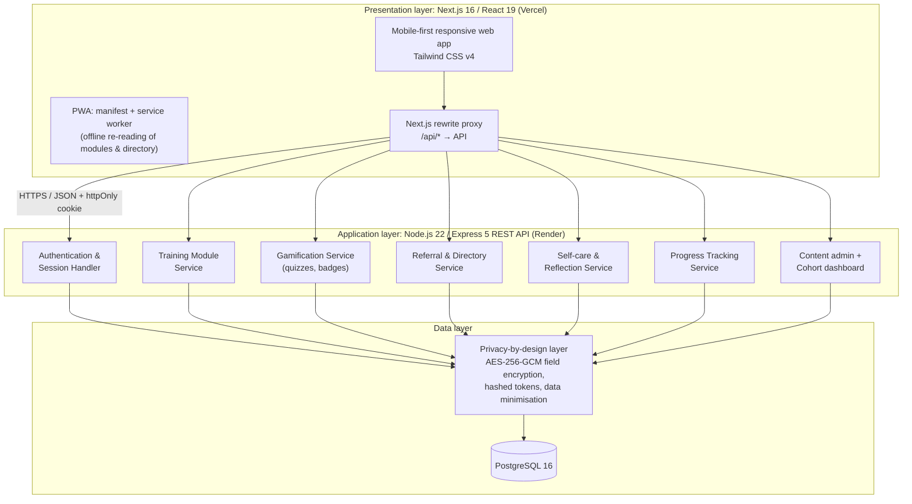

# System Architecture

Beacon follows the three-layer client–server architecture from proposal
Figure 3.3.



## Code map

| Proposal service (Fig 3.3) | Route (HTTP) | Service (logic + SQL) |
|---|---|---|
| Authentication & Session Handler | `server/src/routes/auth.routes.ts` | `server/src/services/auth.service.ts`, `middleware/auth.ts` |
| Training Module Service | `routes/training.routes.ts` | `services/training.service.ts` |
| Gamification Service | `routes/quiz.routes.ts`, `routes/scenarios.routes.ts`, `routes/skill-check.routes.ts` | `services/gamification.service.ts`, `services/scenario.service.ts`, `services/skill-check.service.ts`, `utils/scoring.ts`, `utils/scenario.ts` |
| Referral & Directory Service | `routes/providers.routes.ts`, `routes/sessions.routes.ts` | `services/referral.service.ts` |
| Self-care & Reflection Service | `routes/reflections.routes.ts` | `services/selfcare.service.ts` |
| Progress Tracking Service | `routes/progress.routes.ts` | `services/progress.service.ts` |
| Feedback (FR8) | `routes/feedback.routes.ts` | `services/feedback.service.ts` |
| Content admin (FR9) | `routes/admin.routes.ts` | `services/admin.service.ts` |
| Cohort dashboard (FR10) | `routes/dashboard.routes.ts` | `services/dashboard.service.ts` |
| Privacy-by-design layer | — | `utils/crypto.ts`, `schemas.ts`, DB constraints |

Each request flows **route → validation (zod) → service → PostgreSQL**. Routes
contain no SQL and services contain no HTTP code, so services can be unit
tested and reused (NFR6).

## Request flow: module completion → referral (Figure 3.7)

```mermaid
sequenceDiagram
    actor P as Peer supporter
    participant UI as Beacon UI (Next.js)
    participant T as Training Service
    participant G as Gamification Service
    participant R as Referral Service
    participant DB as PostgreSQL
    P->>UI: Open "Healthy Boundaries"
    UI->>T: GET /api/modules/boundaries
    T->>DB: module + sections + my views
    DB-->>T: rows
    T-->>UI: module JSON (no quiz answers)
    loop each section
        UI->>T: POST /api/modules/boundaries/sections/:id/view
        T->>DB: insert view; mark complete when all viewed
    end
    UI->>G: POST /api/quiz/boundaries/submit {answers}
    G->>DB: store attempt, award badge (first pass only)
    G-->>UI: score, per-question feedback, badge
    UI->>R: GET /api/providers?category=academic
    R->>DB: search (parameterised ILIKE)
    R-->>UI: matching providers
    UI->>R: POST /api/sessions {category, notes, providerId}
    R->>DB: encrypt notes → insert session + referral (transaction)
    UI-->>P: "Session logged" + self-care nudge
```

## Security & privacy controls (NFR1)

| Control | Implementation |
|---|---|
| Authentication | Random 256-bit session token in an **httpOnly, SameSite=Lax, Secure (prod)** cookie; only its SHA-256 hash is stored; 7-day expiry |
| Passwords | bcrypt (12 rounds); constant-time path for unknown usernames |
| Authorisation | `requireAuth` + `requireRole('admin' \| 'coordinator')` middleware; every query is scoped to `req.user.id` |
| Data minimisation | Pseudonymous username; no email, phone or real name; the UI warns against identifying details in notes |
| Encryption at rest | Session notes and reflection text encrypted with AES-256-GCM (authenticated) using an app key from `ENCRYPTION_KEY` |
| Encryption in transit | HTTPS on Vercel and Render |
| Anonymous feedback | `feedback` table has no user column |
| Aggregate-only reporting | Coordinator endpoint returns counts and averages; averages from fewer than 3 responses are suppressed |
| Right to erasure | `DELETE /api/auth/me` cascades to all personal data |
| Input validation | zod schemas on every write; parameterised SQL; LIKE wildcards escaped |
| Hardening | helmet security headers, CORS allow-list, JSON body limit, rate limiting on login/registration/feedback, no stack traces to clients |
| Same-origin API | Next.js proxies `/api/*`, so the browser never needs a third-party cookie |

## Offline / PWA (NFR2)

`public/sw.ts` caches the app shell and static assets (cache-first) and
network-first caches **non-sensitive** GET responses (modules, directory,
progress). Session notes and reflections are never cached, and the API cache
is deleted on sign-out. The manifest and PNG icons are generated by Next.js
(`app/manifest.ts`, `app/icons/[size]/route.tsx`).
