# Database Schema & Data Model

PostgreSQL 16+. The schema is created by versioned SQL migrations in
[`server/migrations`](../server/migrations) (run with
`npm run db:migrate`) and implements the ERD in proposal Figure 3.5, with a few
additions for security and privacy noted below.

## Entity relationship diagram

```mermaid
erDiagram
    USERS ||--o{ AUTH_SESSIONS : "signs in with"
    USERS ||--o{ SECTION_VIEWS : reads
    USERS ||--o{ MODULE_PROGRESS : "progresses through"
    USERS ||--o{ QUIZ_ATTEMPTS : attempts
    USERS ||--o{ BADGES : earns
    USERS ||--o{ SUPPORT_SESSIONS : logs
    USERS ||--o{ REFLECTIONS : writes
    TRAINING_MODULES ||--o{ MODULE_SECTIONS : contains
    TRAINING_MODULES ||--|| QUIZZES : "assessed by"
    TRAINING_MODULES ||--o{ MODULE_PROGRESS : "tracked by"
    TRAINING_MODULES ||--o{ QUIZ_ATTEMPTS : "for"
    TRAINING_MODULES ||--o{ BADGES : awards
    MODULE_SECTIONS ||--o{ SECTION_VIEWS : "viewed in"
    SUPPORT_SESSIONS ||--o| REFERRALS : "may produce"
    PROVIDERS ||--o{ REFERRALS : receives
    TRAINING_MODULES ||--o{ SCENARIOS : "practised in"
    SCENARIOS ||--o{ SCENARIO_COMPLETIONS : "completed as"
    USERS ||--o{ SCENARIO_COMPLETIONS : plays
    USERS ||--o{ SKILL_CHECK_ATTEMPTS : takes

    USERS {
        int user_id PK
        text username UK "pseudonym only"
        text password_hash "bcrypt"
        text role "peer | admin | coordinator"
        text university
        timestamptz consent_at
        timestamptz created_at
    }
    AUTH_SESSIONS {
        int auth_session_id PK
        int user_id FK
        text token_hash UK "SHA-256 of session token"
        timestamptz expires_at
    }
    TRAINING_MODULES {
        int module_id PK
        text slug UK
        text title
        text topic "core competency"
        text summary
        int order_index
        int estimated_minutes
        text status "draft | published | archived"
        bool content_verified
    }
    MODULE_SECTIONS {
        int section_id PK
        int module_id FK
        int order_index
        text heading
        text body
        text media_type "image | video"
        text media_url
    }
    QUIZZES {
        int quiz_id PK
        int module_id FK,UK
        int passing_score "percent"
        jsonb questions "prompt, options, answerIndex, explanation"
    }
    SECTION_VIEWS {
        int user_id PK,FK
        int section_id PK,FK
        timestamptz viewed_at
    }
    MODULE_PROGRESS {
        int progress_id PK
        int user_id FK
        int module_id FK
        text status "in_progress | completed"
        timestamptz completed_at
    }
    QUIZ_ATTEMPTS {
        int attempt_id PK
        int user_id FK
        int module_id FK
        int score
        bool passed
        timestamptz created_at
    }
    BADGES {
        int badge_id PK
        int user_id FK
        int module_id FK
        text type
        text title
        timestamptz earned_at
    }
    PROVIDERS {
        int provider_id PK
        text name
        text service_type
        text description
        bool on_campus
        text district
        text location
        text contact
        text hours
        bool verified
        bool archived
    }
    SUPPORT_SESSIONS {
        int session_id PK
        int user_id FK
        text category
        text notes_enc "AES-256-GCM ciphertext"
        text outcome
        timestamptz created_at
    }
    REFERRALS {
        int referral_id PK
        int session_id FK
        int provider_id FK
        text status
        timestamptz created_at
    }
    REFLECTIONS {
        int reflection_id PK
        int user_id FK
        int mood_rating "1-5"
        text free_text_enc "AES-256-GCM ciphertext"
        timestamptz created_at
    }
    SCENARIOS {
        int scenario_id PK
        text slug UK
        int module_id FK "nullable, SET NULL on delete"
        text title
        jsonb persona "name, context, tone"
        jsonb script "branching steps and endings"
        text status "draft | published | archived"
        boolean sensitive "risk topic: care note, admin can hide"
        boolean content_verified
    }
    SCENARIO_COMPLETIONS {
        int completion_id PK
        int user_id FK
        int scenario_id FK
        int insight_score "0-100"
        timestamptz completed_at
    }
    SKILL_CHECK_ATTEMPTS {
        int attempt_id PK
        int user_id FK
        text kind "pre | post"
        int score "0-100"
        jsonb results "per module: correct, total, level"
        timestamptz created_at
    }
    FEEDBACK {
        int feedback_id PK
        smallint_array sus_answers "10 items, 1-5"
        numeric sus_score "0-100"
        text comment
        timestamptz created_at
    }
```

`FEEDBACK` deliberately has **no relationship to `USERS`**, so System Usability
Scale responses are anonymous by construction (FR8).

## Tables

| Table | Purpose | Requirement |
|---|---|---|
| `users` | Pseudonymous accounts with a role | FR1 |
| `auth_sessions` | Server-side session tokens (stored hashed), expiring | FR1, NFR1 |
| `training_modules` | Module metadata and publishing workflow | FR2, FR9 |
| `module_sections` | Ordered content blocks (text plus optional image, video or audio) | FR2 |
| `quizzes` | One quiz per module; questions in JSONB | FR4 |
| `section_views` | Which sections each user has read | FR3 |
| `module_progress` | Module status; `completed` once every section is viewed | FR3 |
| `quiz_attempts` | Every attempt with score and pass/fail | FR4, evaluation |
| `badges` | One mastery badge per user per module (unique constraint) | FR4 |
| `providers` | Referral directory, with `verified` and soft-delete `archived` flags | FR5, FR9 |
| `support_sessions` | Logged sessions; notes encrypted | FR6 |
| `referrals` | Optional referral from a session to a provider | FR6 |
| `reflections` | Self-care mood check-ins; free text encrypted | FR7 |
| `feedback` | Anonymous SUS answers and computed score | FR8 |
| `scenarios` | Practice conversations: persona and branching script (JSONB), linked to a module | FR4, FR9 |
| `scenario_completions` | One row per finished play-through with its insight score (individual choices are not stored) | FR4, evaluation |
| `skill_check_attempts` | Placement / pre-post knowledge results per module (RQ3) | FR4, evaluation |
| `schema_migrations` | Applied migration log (created by the runner) | — |

## Changes from the proposal ERD (and why)

| Change | Reason |
|---|---|
| `USER.session_token` → separate `auth_sessions` table with hashed tokens and expiry | Allows multiple devices, logout and expiry; a database leak cannot be replayed as logins |
| Added `module_sections` and `section_views` | FR3 requires marking a module complete "when all sections have been viewed", so sections must be first-class |
| Added `quizzes` (JSONB questions) | Quiz content is editable by admins (FR9); JSONB keeps questions with their options together |
| `notes` / `free_text` stored as `*_enc` ciphertext | Encryption at rest of the most sensitive free text (NFR1, §3.6) |
| Added `content_verified` / `verified` flags | Enforces the ethics commitment that content and referrals are approved by Solid Minds before use |
| Added `feedback` table without `user_id` | Anonymous SUS collection (FR8) |
| Added `consent_at` | Records informed consent at registration |
| Added `scenarios`, `scenario_completions`, `skill_check_attempts` (migration 002) | Scenario role-plays and the skill check (supervisor feedback); the skill check also gives the pre/post knowledge measure for RQ3 |
| Added `training_modules.source_note` | Records where content comes from (the Solid Minds training) until it is verified |

## Integrity & performance

- Foreign keys use `ON DELETE CASCADE` from `users`, so **deleting an account removes all of that person's data** (right to erasure). Referrals keep a plain FK to `providers`; providers are archived, never hard-deleted.
- `CHECK` constraints enforce enums (roles, categories, outcomes, statuses) and ranges (mood 1–5, score 0–100).
- Indexes cover the hot paths: a user's sessions and reflections by date, quiz attempts per user/module, sections per module, and non-archived providers by type.
- All queries are parameterised (`$1, $2…`); user search input is escaped for `ILIKE`.
