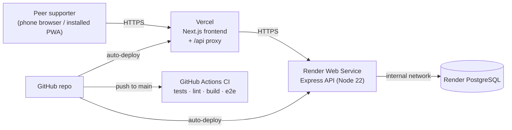

# Deployment Plan

## Target infrastructure (pilot)

| Component | Platform | Plan | Why |
|---|---|---|---|
| Frontend | **Vercel** | Hobby (free) | Native Next.js hosting, global CDN, automatic HTTPS and preview deployments per pull request |
| API | **Render** Web Service | Free → Starter for the pilot | Simple Node hosting, health checks, Blueprint (`render.yaml`) as infrastructure-as-code |
| Database | **Render PostgreSQL** | Free → Basic for the pilot | Same private network as the API |
| Domain | Any registrar (budget line in proposal Table 1.1) | ~40,000 RWF | Point to Vercel; optional |
| CI | **GitHub Actions** | Free | `.github/workflows/ci.yml` gates every push and PR |

> **Free-tier caveats, to budget for before the pilot.** Render's free web
> service sleeps after 15 minutes idle (about 50s cold start, which breaks the
> 3-second target in NFR2), and the free Postgres instance expires after 30 days.
> For the two-month pilot, upgrade the API to *Starter* and the database to
> *Basic*, or use a free external Postgres such as Neon and set
> `DATABASE_SSL=true`.

## Environments

| Environment | Frontend | API | Database |
|---|---|---|---|
| Local | `localhost:3000` | `localhost:4000` | Docker `localhost:5433` (or native Postgres) |
| CI | built and started in the runner | started in the runner | Postgres service container |
| Preview | Vercel preview URL per PR | (shares production API, or a Render preview env) | — |
| Production | `https://<project>.vercel.app` or custom domain | `https://beacon-api.onrender.com` | Render Postgres |

## Step-by-step: first deployment

### 1. Backend + database on Render
1. Push the repository to GitHub.
2. Render dashboard → **New → Blueprint** → select the repo. Render reads `render.yaml` and creates `beacon-api` and `beacon-db`.
3. When prompted, set the secrets:
   - `ENCRYPTION_KEY`: generate with `node -e "console.log(require('crypto').randomBytes(32).toString('base64'))"`. **Store it safely.** Losing it makes existing notes unreadable.
   - `SEED_ADMIN_PASSWORD`, `SEED_COORDINATOR_PASSWORD`, `SEED_DEMO_PASSWORD`: strong, unique passwords.
   - `CORS_ORIGINS`: your Vercel URL (set after step 2; only needed for direct API clients).
4. Deploy. The start command runs migrations and the idempotent seed, then starts the API. Check `https://<api>.onrender.com/api/health` returns `{"status":"ok"}`.

### 2. Frontend on Vercel
1. Vercel → **Add New Project** → import the repo.
2. **Root Directory:** `client` (framework auto-detected as Next.js).
3. Environment variable: `API_URL = https://<api>.onrender.com`.
4. Deploy, then open the site, sign in as `admin` and check the modules and directory.

### 3. Post-deploy checklist
- [ ] `/api/health` OK through the frontend: `https://<site>/api/health`
- [ ] Register a test peer, complete a module, pass the quiz, log a session with a referral
- [ ] Coordinator dashboard loads and shows aggregates only
- [ ] Lighthouse (mobile): PWA installable, performance ≥ 80 on "Slow 4G"
- [ ] Replace placeholder directory entries and module text with verified content, then tick **Content verified**
- [ ] Set up an uptime monitor (e.g. UptimeRobot) on `/api/health` to track the 99% target (NFR4)

## Continuous integration & delivery

1. Every push/PR runs **CI**: API unit and integration tests against a real Postgres (with coverage), frontend lint and production build, then Playwright end-to-end tests of the full stack.
2. Merging to `main` triggers **automatic deploys** on Vercel and Render. (Optionally enable "deploy only if CI passes" in Render, and Vercel's GitHub checks.)
3. Database changes ship as new numbered files in `server/src/db/migrations/` and are applied automatically on start; migrations are forward-only.

## Operations

| Concern | Approach |
|---|---|
| Secrets | Only in Render/Vercel env settings; `.env` files are git-ignored |
| Backups | Render Postgres daily backups (paid plans), plus a weekly `pg_dump` during the pilot |
| Monitoring | Render logs + health check; uptime monitor on `/api/health` |
| Rollback | Vercel "Promote previous deployment"; Render "Rollback" to the previous deploy |
| Data retention | At study end, export aggregates for analysis, then delete the database per the ethics protocol |
| Scaling (NFR5) | Stateless API scales horizontally on Render; Postgres connection pool (max 10 per instance); 200 concurrent users fit comfortably on Starter |
